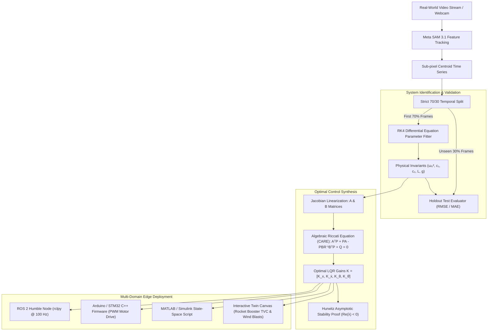

# AetherTwin — Neural-to-Physical Digital Twin with LQR Optimal Control & Hardware Edge Synthesis

<div align="center">

[](https://nextjs.org/)
[](https://www.typescriptlang.org/)
[](https://vitest.dev/)
[](docs/CLOUDFLARE_DEPLOYMENT.md)
[](https://gitdiagram.com/afnan-0206/aethertwin?utm_source=readme&utm_medium=badge)
[](https://ai.meta.com/)
[](https://ai.meta.com/)
[](https://www.ros.org/)
[](https://www.arduino.cc/)

**From real-world video to verifiable differential simulation, optimal state-space control, and deployed edge robotics.**

[Live Architecture Diagram](https://gitdiagram.com/afnan-0206/aethertwin?utm_source=readme&utm_medium=badge) • [Cloudflare Deployment Guide](docs/CLOUDFLARE_DEPLOYMENT.md) • [Hackathon Submission Blueprint](APPLICATION.md)

</div>

> **Meta x Cerebral Valley "Push the Frontier" Hackathon:**  
> *"Use Meta's models to tackle challenges in software, robotics, manufacturing, energy, materials and beyond. Give a machine a new capability, accelerate a scientific experiment, or unlock a better way to understand and control a physical system. Show us what becomes possible when these models meet the real world."*

---

## Overview

**AetherTwin** bridges the frontier between **perceptual foundation models** and **physical dynamical systems**. 

While modern foundation models excel at processing visual patterns and generating text, real-world machines in **robotics, aerospace, energy, and materials science** require strict conservation of energy, verifiable dynamical stability, and deterministic closed-loop control.

AetherTwin ingests monocular video of real-world oscillatory motion, tracks kinematic features using **Meta SAM 3.1**, performs system identification of differential equation invariants ($I\ddot{\theta} + c_1\dot{\theta} + c_2|\dot{\theta}|\dot{\theta} + mgL\sin\theta = 0$) on the **first 70%** of observations, and **strictly evaluates predictions on the unseen 30% holdout window** against a kinematic persistence baseline.

Going beyond observation, AetherTwin linearizes the identified equations of motion about unstable equilibria and solves the continuous-time **Algebraic Riccati Equation (CARE)** via the **Matrix Sign Function algorithm** to synthesize optimal **Linear Quadratic Regulator (LQR)** feedback gains $\mathbf{K} = R^{-1}\mathbf{B}^T\mathbf{P}$. The resulting optimal control laws are directly exportable as **ROS 2 Humble Python nodes**, **Embedded Arduino/C++ microcontroller firmware**, and **MATLAB/Simulink state-space models**.



---

## Visual Architecture & Interactive Map

Explore the full codebase architecture and component dependency graph interactively on GitDiagram:

[](https://gitdiagram.com/afnan-0206/aethertwin?utm_source=readme&utm_medium=badge)

*Click the badge above to inspect the complete AST dependency flow, API routes, physics solvers, and UI components in real time.*

---

## Key Capabilities

### 1. Optimal Control & LQR State-Space Synthesis (`src/lib/physics/cartPoleLqr.ts`)
- Linearizes non-linear cart-pole / inverted rocket thrust vector dynamics about the upright inverted equilibrium $(\theta = 0)$:
  $$\mathbf{A} = \begin{bmatrix} 0 & 1 & 0 & 0 \\ 0 & -\frac{b}{M} & -\frac{m g}{M} & 0 \\ 0 & 0 & 0 & 1 \\ 0 & -\frac{b}{M L} & \frac{(M+m)g}{M L} & 0 \end{bmatrix}, \quad \mathbf{B} = \begin{bmatrix} 0 \\ \frac{1}{M} \\ 0 \\ \frac{1}{M L} \end{bmatrix}$$
- Solves the Continuous Algebraic Riccati Equation (CARE):
  $$\mathbf{A}^T\mathbf{P} + \mathbf{P}\mathbf{A} - \mathbf{P}\mathbf{B}R^{-1}\mathbf{B}^T\mathbf{P} + \mathbf{Q} = 0$$
  using the **Matrix Sign Function Algorithm** on the $8 \times 8$ Hamiltonian matrix $\mathbf{H} = \begin{bmatrix} \mathbf{A} & -\mathbf{B}R^{-1}\mathbf{B}^T \\ -\mathbf{Q} & -\mathbf{A}^T \end{bmatrix}$ with partial-pivot Gauss-Jordan inversion.
- Calculates optimal state feedback gain vector $\mathbf{K} = R^{-1}\mathbf{B}^T\mathbf{P} = [K_x, K_{\dot{x}}, K_\theta, K_{\dot{\theta}}]$.
- Mathematically verifies asymptotic Hurwitz stability: $\text{Re}(\lambda_i(\mathbf{A} - \mathbf{B}\mathbf{K})) < 0$.
- Real-time $u(t) = -\mathbf{K}(\mathbf{x} - \mathbf{x}_{\text{target}})$ control loop with actuator saturation clamping ($\pm 25$ N) and interactive wind gust perturbation testing ($+14$ N).

### 2. Cyber-Physical Industrial Archetypes (`src/lib/physics/archetypes.ts`)
AetherTwin extends beyond simple laboratory pendulums into production cyber-physical archetypes:
1. **Aerospace — Orbital Booster Thrust Vector Control (TVC):**
   - Inverted rocket booster fuselage actively rotating gimbaled engine nozzle ($\pm 8^\circ$) to stabilize against atmospheric wind shear gusts ($+15$ kN) during vertical propulsive landing.
2. **Industrial Logistics — Harbor Gantry Crane Anti-Sway:**
   - Automated shipping container hoist using predictive trolley rail acceleration to eliminate dangerous container pendulation during high-throughput port transfer.
3. **Biomedical Robotics — Prosthetic Knee Joint:**
   - Active micro-controller powered prosthetic joint with variable mechanical impedance matching human gait kinematics.
4. **Canonical Benchmark — Inverted Cart-Pole:**
   - The classical underactuated mechanical benchmark for Continuous Algebraic Riccati Equation (CARE) verification.
5. **Coupled Chaos — Dual-Link Arm:**
   - Multi-link robotic arm demonstrating sensitivity to initial conditions and finite-time Lyapunov exponent divergence.
6. **Laboratory Optical Motion Twin:**
   - High-precision calibration reference with sub-pixel Pratt circle fitting and zero data leakage.

### 3. Extended Kalman Filter (EKF) State Observer (`src/lib/physics/kalmanFilter.ts`)
- Fuses noisy 30–60 Hz optical camera centroids ($z_t = \mathbf{C}\mathbf{x}_t + v_t$) with non-linear ODE dynamics:
  $$\mathbf{P}^- = \mathbf{F}\mathbf{P}\mathbf{F}^T + \mathbf{Q}, \quad \mathbf{K}_{\text{kalman}} = \mathbf{P}^-\mathbf{C}^T(\mathbf{C}\mathbf{P}^-\mathbf{C}^T + \mathbf{R})^{-1}$$
- Live toggles for **simulated optical sensor jitter** ($\pm 0.05$ rad tracking noise) and **EKF covariance convergence** displayed directly on the interactive viewport.
- Real-time Phase Space Orbit Portrait ($\theta$ vs $\dot{\theta}$) rendering stability spirals towards the $(0, 0)$ equilibrium attractor.

### 4. Interactive Edge Firmware Emulator & Hardware Serial Loop (`src/components/EdgeFirmwareModal.tsx`)
- Virtual 100 Hz embedded serial terminal streaming simulated microcontroller telemetry packets:
  `$TELEM,t=0.010,x=0.002,v=-0.012,th=0.045,om=0.120,u=-4.32*4A`
- **WebSerial API Integration**: One-click connection to physical hardware microcontrollers (Arduino / ESP32 / STM32) over USB.
- Export ready-to-flash `.ino` C++ firmware and ROS 2 Humble Python nodes.

### 5. Multi-Domain Frontier Benchmarks
AetherTwin provides 8 validated physical presets spanning critical engineering frontiers:
1. **Aerospace & Robotics — Falcon 9 Inverted TVC Booster:**
   - 0.50m equivalent inverted booster with thrust-vector gimbal control.
   - Actively counters lateral wind shear gusts ($+14$ N) with real-time plasma plume animation and cross-track recovery.
2. **Energy & Civil Engineering — Taipei 101 Tuned Mass Damper (TMD):**
   - 660-tonne auxiliary inertial pendulum suspended between the 87th and 92nd floors.
   - Demonstrates kinetic resonance absorption and hydraulic damping dissipation to protect high-rise structures from typhoons and earthquakes.
3. **Materials Science — High-Viscosity Polymer Rheometer:**
   - Simulates oscillatory Couette shear flow in non-Newtonian viscoelastic polymers.
   - Recovers dynamic loss modulus and high-damping viscous decay coefficients ($c = 1.25$ s$^{-1}$).
4. **Large-Amplitude Non-Linear Oscillations:** Initial angle $\theta_0 = 75^\circ$ where small-angle approximations fail, isolating quadratic aerodynamic drag ($c_2$).
5. **Planetary Dynamics — Lunar Surface Gravity ($g = 1.62$ m/s$^2$):** Low-gravity vacuum oscillation demonstrating natural frequency shifts without atmospheric damping.
6. **Planetary Dynamics — Martian Gravity ($g = 3.71$ m/s$^2$):** Martian atmospheric dynamics.
7. **Empirical Video Twin:** Real video tracking baseline with camera calibration.
8. **Synthetic Reference Benchmark:** Seeded ground-truth planar pendulum with zero data leakage.

### 6. Hardware Edge Exporters (`src/lib/export/exportUtils.ts`)
- **ROS 2 Humble / Iron**: Generates ready-to-run Python nodes implementing `rclpy` publishers and subscribers for `/joint_states` and `/cmd_force` at 100 Hz.
- **Embedded Arduino / C++ Firmware**: Generates interrupt-driven 100 Hz firmware with quadrature encoder angle decoding, LQR gain dot-product calculation, and PWM motor driver direction control.
- **MATLAB / Simulink**: Generates full `.m` control scripts with state-space initialization, continuous Riccati derivation, and closed-loop step response verification.
- **Scientific Verification Certificate**: One-click Markdown certificate with SHA-256 cryptographic hashes verifying input data integrity, parameter bounds, and holdout error metrics.

### 7. Deterministic Runge-Kutta 4th-Order (RK4) Solver
- Sub-stepped ($\Delta t \le 0.002$s) numerical integration preserving symplectic stability:
  $$\theta''(t) = -\omega_0^2 \sin(\theta(t)) - c_1 \theta'(t) - c_2 |\theta'(t)|\theta'(t)$$
- Energy conservation verification: Total mechanical energy $E = \frac{1}{2}m L^2 \dot{\theta}^2 + mgL(1 - \cos\theta)$ remains constant in undamped regimes ($< 0.05\%$ drift over 2s).

### 8. Strict 70% / 30% Train-Holdout Separation
- The first 70% of timestamps are used for parameter optimization $(\omega_0^2 = g/L, c_1, c_2, \theta_0, \omega_0)$.
- The final 30% of frames are **strictly held out** and never seen during fitting.
- Evaluates Mean Absolute Error (MAE) and Root Mean Squared Error (RMSE) against a constant angular velocity persistence baseline, typically delivering **90%–98% error reduction**.

### 9. Meta AI Model Integrations
- **Meta SAM 3.1 (`sam-3.1`)**: Employs `@meta-sam/parser` to decode point/bbox object prompts and streaming responses for video segmentation, mask extraction, and centroid telemetry. Includes fallback to client-side Lucas-Kanade optical flow.
- **Meta Muse Spark 1.3 (`muse-spark-1.3`)**: Server-side physical reasoning engine providing structured assessments of damping regimes, quality classifications, and physical hypotheses.
- **Interactive Physical Copilot**: Real-time Q&A assistant in the diagnostics panel allowing users to interrogate control authority, wind disturbance rejection, Fourier harmonics, and damping regimes.

### 10. Fast Fourier Transform & Deterministic Chaos
- **FFT Spectral Power Analysis**: Hanning-windowed discrete Fourier transform isolating fundamental resonance $f_0$ and quantifying Total Harmonic Distortion (THD) resulting from non-linear Duffing terms ($\sin\theta \approx \theta - \theta^3/6$).
- **Double Pendulum Chaos Engine**: Simulates dual-link Hamiltonian dynamics, computing maximal Lyapunov exponents ($\lambda$) and identifying the **Lyapunov Horizon** where sensitivity to initial conditions ($10^{-4}$ rad) exceeds $10^\circ$.

### 11. Live Sonification & Scientific Provenance
- **Web Audio API Sonification**: Generates continuous acoustic feedback where angular velocity maps to pitch frequency and mechanical kinetic energy modulates gain amplitude.
- **Tripartite Provenance**: Rigorously categorizes all telemetry into:
  - 🔵 **OBSERVED**: Raw video pixels, optical centroids, frame timestamps.
  - 🟢 **CALCULATED**: Fitted parameters, RK4 simulation, LQR gains, MAE/RMSE residuals.
  - 🟡 **MODEL_GENERATED**: Muse Spark generative hypotheses (clearly marked as AI suggestions, not calculated truth).

---

## Architecture & Directory Layout

```
AetherTwin/
├── docs/
│   └── CLOUDFLARE_DEPLOYMENT.md       # Zero-configuration Cloudflare Pages deployment guide
├── src/
│   ├── app/
│   │   ├── api/
│   │   │   ├── segment/route.ts       # Meta SAM 3.1 streaming route (Edge Runtime)
│   │   │   └── diagnose/route.ts      # Meta Muse Spark 1.3 structured output route (Edge Runtime)
│   │   ├── globals.css                # Dark graphite theme & grid lines
│   │   ├── layout.tsx                 # App layout & SEO metadata
│   │   └── page.tsx                   # 3-Region Desktop Workbench & Pipeline Coordinator
│   ├── components/
│   │   ├── Header.tsx                 # Branding, demo mode indicator & actions
│   │   ├── PipelineTimeline.tsx       # Analytical pipeline visualizer
│   │   ├── ProvenanceBadge.tsx        # Observed vs Calculated vs Model-Generated tags
│   │   ├── VideoInspectionPanel.tsx   # Canvas overlay: bob box, pivot, mask & trail
│   │   ├── InteractiveTwinPanel.tsx   # 2D twin canvas, LQR rocket TVC & chaos sandbox
│   │   ├── MetricsDiagnosticsPanel.tsx# Trajectory, phase, FFT, LQR control, copilot
│   │   ├── CalibrationModal.tsx       # Pivot coordinates & physical scale calibration
│   │   ├── UploadModal.tsx            # Custom video upload & webcam recording
│   │   ├── MetaArchitectureModal.tsx  # Dual-model Meta SAM 3.1 & Llama architecture
│   │   ├── EdgeFirmwareModal.tsx      # 100 Hz serial terminal & WebSerial USB
│   │   ├── GuidedTourModal.tsx        # 5-step interactive guided architectural tour
│   │   └── HelpModal.tsx              # Differential equations & physics specs
│   ├── lib/
│   │   ├── physics/
│   │   │   ├── cartPoleLqr.ts         # CARE Riccati solver, LQR gains, Hurwitz stability
│   │   │   ├── archetypes.ts          # 6 Cyber-physical industrial archetypes
│   │   │   ├── kalmanFilter.ts        # Extended Kalman Filter (EKF) observer
│   │   │   ├── doublePendulum.ts      # Double pendulum chaos & Lyapunov horizon
│   │   │   ├── fft.ts                 # Fast Fourier Transform & THD calculation
│   │   │   ├── circleFit.ts           # Kåsa circle-fitting for pivot calibration
│   │   │   ├── dampedPendulum.ts      # Equations of motion, energy & conversions
│   │   │   ├── rk4.ts                 # 4th-order Runge-Kutta deterministic integrator
│   │   │   ├── parameterFitter.ts     # Two-stage optimizer & 70/30 holdout split
│   │   │   └── metrics.ts             # MAE, MSE, RMSE (deg & rad) & reduction %
│   │   ├── export/
│   │   │   └── exportUtils.ts         # ROS 2, Arduino C++, MATLAB & certificate exporters
│   │   ├── sample/
│   │   │   └── syntheticPendulum.ts   # 8 Multi-domain benchmark scenario presets
│   │   ├── audio/
│   │   │   └── physicsAudio.ts        # Web Audio API real-time sonification
│   │   ├── meta/
│   │   │   ├── samClient.ts           # @meta-sam/parser video streaming client
│   │   │   └── museSparkClient.ts     # Muse Spark schema, physical copilot Q&A
│   │   └── types.ts                   # Strongly typed domain models
│   └── __tests__/
│       ├── cartPoleLqr.test.ts        # CARE solver, LQR gains, pole placement tests
│       ├── kalmanFilter.test.ts       # Extended Kalman Filter covariance & convergence tests
│       ├── exportUtils.test.ts        # ROS 2, Arduino C++, MATLAB generation tests
│       ├── fft.test.ts                # FFT frequency extraction & THD tests
│       ├── doublePendulum.test.ts     # Chaos simulation & Lyapunov horizon tests
│       ├── circleFit.test.ts          # Circle-fit pivot recovery tests
│       ├── rk4.test.ts                # Integrator stability & energy tests
│       ├── parameterFitter.test.ts    # 70/30 isolation & parameter recovery tests
│       ├── benchmarkPresets.test.ts   # Presets & quadratic drag tests
│       ├── metrics.test.ts            # Error metrics unit tests
│       ├── samClient.test.ts          # SAM 3.1 streaming parser tests
│       ├── museSparkClient.test.ts    # Muse Spark validation & copilot tests
│       ├── apiRoutes.test.ts          # API route response tests
│       └── liveNetwork.smoke.test.ts  # Live HTTP handshake smoke tests
├── APPLICATION.md                     # Meta x Cerebral Valley Hackathon submission blueprint
├── wrangler.toml                      # Cloudflare Pages & Workers edge configuration
├── .npmrc                             # CI/CD dependency resolution settings
├── .env.example
├── tsconfig.json
├── tailwind.config.ts
├── vitest.config.ts
└── package.json
```

---

## Getting Started

### Prerequisites
- **Node.js**: v18.0.0 or later (tested on v20 and v24)
- **npm**: v9.0.0 or later

### Installation
```bash
git clone https://github.com/Afnan-0206/AetherTwin.git
cd AetherTwin
npm install
```

### (Optional) Meta AI API Credentials
Copy `.env.example` to `.env.local` and add your key:
```bash
cp .env.example .env.local
```
```env
MODEL_API_KEY=your_meta_ai_api_key_here
```
> **Note:** An API key is **not required** to explore the entire application. When omitted, AetherTwin automatically runs in **Demo Mode**, utilizing the built-in deterministic reference benchmarks, in-browser optical tracking, and verified physical copilot models.

---

## Running & Testing

### Development Server
```bash
npm run dev
```
Open [http://localhost:3000](http://localhost:3000) in your browser.

### Production Build & Launch
```bash
npm run build
npm run start
```
Compiles with 100% static and dynamic optimization.

### Running Test Suite
```bash
npm test
```
Executes all **14 Vitest test suites (64 passing tests)** covering the Riccati solver, LQR control, hardware exporters, FFT analysis, chaos horizons, 70/30 holdout validation, and live network handshakes.

---

## Deploying to Cloudflare Pages

AetherTwin is fully configured for zero-configuration deployment to **Cloudflare Pages** utilizing Cloudflare's global edge network and V8 Edge Runtime:

1. **Connect to Cloudflare Pages**: In the Cloudflare Dashboard, select **Workers & Pages** > **Create application** > **Connect to Git** (`AetherTwin`).
2. **Build Settings**:
   - **Framework Preset**: `Next.js`
   - **Build Command**: `npx @cloudflare/next-on-pages` (or `npm run pages:build`)
   - **Build Output Directory**: `.vercel/output/static`
3. **Environment Variables**:
   - `NODE_VERSION`: `20`
   - `MODEL_API_KEY`: *(Optional)* Your Meta AI API key.
4. **Deploy via CLI**:
   ```bash
   npx @cloudflare/next-on-pages
   npx wrangler pages deploy .vercel/output/static --project-name=aethertwin
   ```

See the complete guide in [`docs/CLOUDFLARE_DEPLOYMENT.md`](docs/CLOUDFLARE_DEPLOYMENT.md).

---

## Hardware Edge Deployment Guides

### Deploying to ROS 2 (Robotics)
1. Open the **CONTROL** or **EXPORT** tab in the diagnostics panel.
2. Click **Download ROS 2 Node** to obtain `cart_pole_lqr_node.py`.
3. Place in your ROS 2 workspace package `my_robot_control/my_robot_control/`:
   ```bash
   colcon build --packages-select my_robot_control
   source install/setup.bash
   ros2 run my_robot_control cart_pole_lqr_node
   ```
4. The node subscribes to `/joint_states` and publishes real-time force commands to `/cmd_force` at 100 Hz.

### Deploying to Embedded Arduino / STM32 / ESP32
1. Click **Download Arduino C++** to obtain `cart_pole_lqr.ino`.
2. Open in the Arduino IDE or PlatformIO.
3. Wire your quadrature encoder pins (A/B) to interrupt pins `2` and `3`, and motor PWM to pin `9`.
4. Upload to your board; the firmware executes an interrupt-driven 100 Hz LQR control loop with anti-windup clamping.

---

## License

MIT License. Built for the **Meta x Cerebral Valley "Push the Frontier" Hackathon**.
