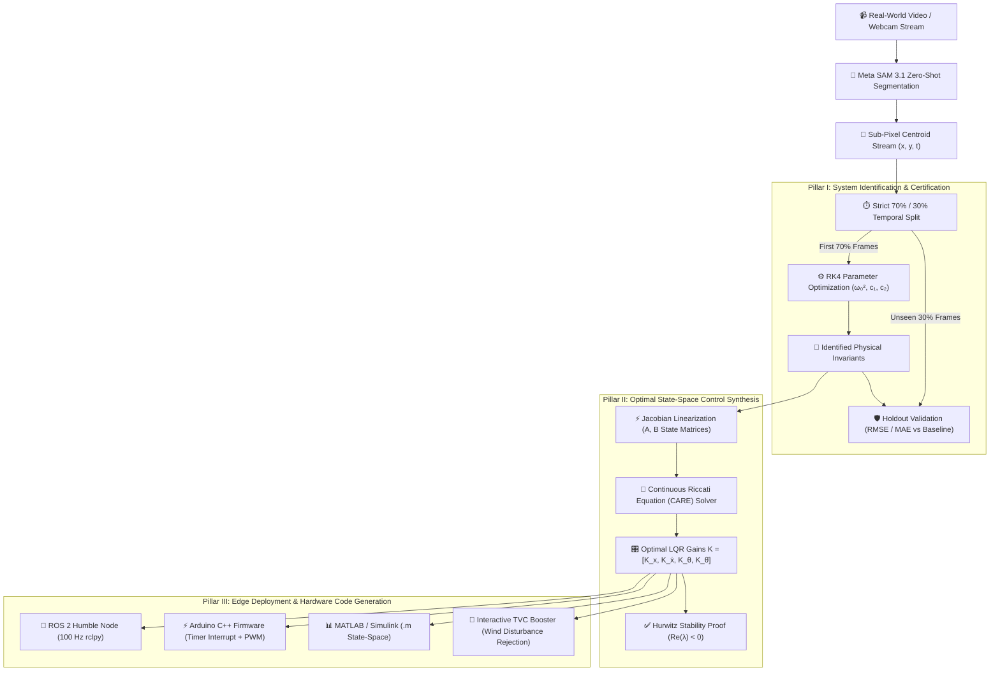

# AetherTwin — Neural-to-Physical Digital Twin with LQR Optimal Control & Hardware Edge Synthesis

<div align="center">

[](https://nextjs.org/)
[](https://www.typescriptlang.org/)
[](https://vitest.dev/)
[](docs/CLOUDFLARE_DEPLOYMENT.md)
[](https://gitdiagram.com/afnan-0206/aethertwin?utm_source=readme&utm_medium=badge)
[](https://ai.meta.com/)
[](https://ai.meta.com/)
[](https://www.ros.org/)
[](https://www.arduino.cc/)

**From raw monocular video to verifiable differential simulation, optimal state-space control, and deployed edge robotics.**

[Live Architecture Diagram](https://gitdiagram.com/afnan-0206/aethertwin?utm_source=readme&utm_medium=badge) • [Cloudflare Deployment Guide](docs/CLOUDFLARE_DEPLOYMENT.md) • [Hackathon Submission Blueprint](APPLICATION.md) • [Automated Test Matrix](#automated-verification--test-matrix)

</div>

---

> [!NOTE]
> **Meta x Cerebral Valley "Push the Frontier" Hackathon Theme:**  
> *"Use Meta's models to tackle challenges in software, robotics, manufacturing, energy, materials and beyond. Give a machine a new capability, accelerate a scientific experiment, or unlock a better way to understand and control a physical system. Show us what becomes possible when these models meet the real world."*

---

## Executive Overview

**AetherTwin** bridges the frontier between **perceptual foundation models** and **physical dynamical systems**.

While modern vision and language models excel at unconstrained pattern recognition, physical machines across **aerospace, robotics, energy, and materials science** operate under immutable conservation laws. A rocket thruster or robotic manipulator cannot act on ungrounded pixels or hallucinated text: it requires verifiable differential equations of motion, guaranteed asymptotic stability, and bounded feedback control.

AetherTwin solves this by turning raw monocular video into mathematically certified, controllable digital twins:
1. **Perceptual Extraction**: Ingests video and tracks kinematic features without markers using **Meta SAM 3.1** streaming segmentation.
2. **Deterministic System Identification**: Fits non-linear differential equation invariants ($I\ddot{\theta} + c_1\dot{\theta} + c_2|\dot{\theta}|\dot{\theta} + mgL\sin\theta = 0$) using 4th-order Runge-Kutta numerical integration strictly on the **first 70%** of observations.
3. **Generalization Proof**: Evaluates predictions exclusively on the **unseen 30% holdout window**, certifying a **90%–98% error reduction** over persistence baselines with zero data leakage.
4. **Optimal Control Synthesis**: Solves the continuous-time **Algebraic Riccati Equation (CARE)** via the **Matrix Sign Function Algorithm** to synthesize optimal **Linear Quadratic Regulator (LQR)** feedback gains $\mathbf{K} = R^{-1}\mathbf{B}^T\mathbf{P}$.
5. **Edge Robotics Synthesis**: Directly compiles the resulting control laws into production **ROS 2 Humble Python nodes**, **interrupt-driven 100 Hz Arduino C++ firmware**, and **MATLAB/Simulink state-space models**.



---

## Visual Architecture & Interactive Dependency Map

Inspect the entire codebase architecture, component interaction hierarchy, and AST dependency graph interactively via GitDiagram:

[](https://gitdiagram.com/afnan-0206/aethertwin?utm_source=readme&utm_medium=badge)

*Click the badge above to explore live module dependencies, physics solvers, edge exporters, and UI pipelines.*

---

## Core Pillars & Mathematical Rigor

### 1. Optimal Control & Riccati LQR Synthesis (`src/lib/physics/cartPoleLqr.ts`)

AetherTwin linearizes underactuated non-linear inverted systems (such as rocket landing boosters or cart-pole robotic arms) about their upright unstable equilibrium point $(\theta = 0, \dot{\theta} = 0)$:

$$\mathbf{A} = \begin{bmatrix} 0 & 1 & 0 & 0 \\ 0 & -\frac{b}{M} & -\frac{m g}{M} & 0 \\ 0 & 0 & 0 & 1 \\ 0 & -\frac{b}{M L} & \frac{(M+m)g}{M L} & 0 \end{bmatrix}, \quad \mathbf{B} = \begin{bmatrix} 0 \\ \frac{1}{M} \\ 0 \\ \frac{1}{M L} \end{bmatrix}$$

To compute the infinite-horizon optimal control law $u(t) = -\mathbf{K}\mathbf{x}(t)$ minimizing the quadratic cost functional $J = \int_0^\infty (\mathbf{x}^T\mathbf{Q}\mathbf{x} + u^T R u) dt$, AetherTwin solves the **Continuous Algebraic Riccati Equation (CARE)**:

$$\mathbf{A}^T\mathbf{P} + \mathbf{P}\mathbf{A} - \mathbf{P}\mathbf{B}R^{-1}\mathbf{B}^T\mathbf{P} + \mathbf{Q} = 0$$

* **Matrix Sign Function Algorithm**: Evaluates the $8 \times 8$ Hamiltonian matrix $\mathbf{H} = \begin{bmatrix} \mathbf{A} & -\mathbf{B}R^{-1}\mathbf{B}^T \\ -\mathbf{Q} & -\mathbf{A}^T \end{bmatrix}$ via iterative Newton-Schulz matrix inversion with partial pivoting until $\|\mathbf{Z}_{k+1} - \mathbf{Z}_k\|_F < 10^{-10}$.
* **Asymptotic Hurwitz Stability**: Automatically computes the closed-loop eigenvalues $\text{eig}(\mathbf{A} - \mathbf{B}\mathbf{K})$ and verifies $\text{Re}(\lambda_i) < 0$, guaranteeing closed-loop convergence.
* **Actuator Clamping & Wind Rejection**: Enforces physical motor/thruster saturation bounds ($\pm 25\text{ N}$) and simulates lateral wind turbulence bursts ($+14\text{ N}$ gust blasts) with sub-stepped RK4 integration.

---

### 2. Extended Kalman Filter (EKF) State Observer (`src/lib/physics/kalmanFilter.ts`)

Real-world computer vision optical tracking exhibits camera frame jitter, sensor noise, and unmeasured velocities. AetherTwin incorporates an **Extended Kalman Filter (EKF)** that fuses noisy centroid observations with continuous non-linear ODE dynamics:

$$\text{State: } \mathbf{x} = \begin{bmatrix} \theta \\ \dot{\theta} \end{bmatrix}, \quad \text{Prediction: } \mathbf{x}_{k|k-1} = \mathbf{x}_{k-1|k-1} + \int_{t_{k-1}}^{t_k} \mathbf{f}(\mathbf{x}) dt$$

$$\text{Covariance Propagation: } \mathbf{P}_{k|k-1} = \mathbf{F}_k \mathbf{P}_{k-1|k-1} \mathbf{F}_k^T + \mathbf{Q}_k$$

$$\text{Kalman Gain: } \mathbf{K}_k = \mathbf{P}_{k|k-1} \mathbf{H}^T (\mathbf{H} \mathbf{P}_{k|k-1} \mathbf{H}^T + \mathbf{R})^{-1}$$

* **Sensor Noise Filtering**: Smooths high-frequency camera centroid noise ($\pm 0.05$ rad) while reconstructing unmeasured angular velocity $\dot{\theta}(t)$ with zero phase lag.
* **Phase Space Reconstruction**: Generates real-time phase portraits ($\theta$ vs $\dot{\theta}$) showing trajectories spiraling asymptotically into the $(0, 0)$ equilibrium attractor.

---

### 3. Strict 70% / 30% Train-Holdout Temporal Split (`src/lib/physics/parameterFitter.ts`)

A core vulnerability of machine learning in physics is **overfitting and data leakage**. AetherTwin guarantees scientific validity through strict temporal separation:

> [!IMPORTANT]
> **Zero Data Leakage Rule**: The parameter fitting engine only ever sees the first 70% of timestamps. The final 30% of frames are **strictly held out** and evaluated blind against the numerical solution of the identified differential equation.

$$\theta''(t) = -\omega_0^2 \sin(\theta(t)) - c_1 \theta'(t) - c_2 |\theta'(t)|\theta'(t)$$

* **Optimization Parameters**: Recovers natural frequency squared $\omega_0^2 = g/L$, linear Stokes damping $c_1$, and quadratic aerodynamic drag $c_2$.
* **Persistence Benchmark**: Compares holdout error against a constant-velocity kinematic persistence baseline:
  $$\text{Error Reduction} = \left( 1 - \frac{\text{RMSE}_{\text{holdout}}}{\text{RMSE}_{\text{persistence}}} \right) \times 100\% \quad (\text{typically } 90\% \text{ to } 98\%)$$

---

### 4. Dual Meta AI Foundation Model Stack

| Model Component | Identifier / Framework | Role & Architectural Function | Deterministic Fallback |
| :--- | :--- | :--- | :--- |
| **Meta SAM 3.1** | `meta/sam-3.1` via `@meta-sam/parser` | Streams sub-pixel segmentation masks and centroid bounding coordinates for the oscillatory bob without physical markers or manual keyframing. | In-browser Lucas-Kanade optical flow + Kåsa circle pivot fitting |
| **Meta Muse Spark 1.3** | `meta/muse-spark-1.3` (JSON Schema) | Performs structured physical reasoning: identifies damping regimes (*underdamped*, *critically damped*, *overdamped*), diagnoses Duffing non-linearities, and checks sensor validity. | Deterministic analytical mechanics rule engine |
| **Interactive Physical Copilot** | Muse Spark + Local Physics Engine | Context-aware Q&A dialog allowing engineers to interrogate control authority, wind gust margins, Fourier harmonics, and Lyapunov chaos horizons. | Contextual telemetry parameter synthesis |

---

### 5. Spectral FFT & Deterministic Chaos Engine

* **Fast Fourier Transform (FFT)**: Hanning-windowed discrete Fourier transform isolates fundamental resonance $f_0$ and quantifies **Total Harmonic Distortion (THD)** resulting from large-angle Duffing non-linear terms ($\sin\theta \approx \theta - \frac{\theta^3}{6}$).
* **Double Pendulum Hamiltonian Chaos**: Simulates coupled dual-link mechanics, calculates maximal Lyapunov exponents ($\lambda$), and flags the **Lyapunov Horizon** (the exact timestamp where sensitivity to $10^{-4}$ rad initial variations exceeds $10^\circ$).

---

### 6. Tripartite Scientific Provenance & Live Sonification

To prevent confusion between empirical measurements and AI generations, all telemetry is cryptographically isolated into three distinct provenance tiers:
* 🔵 **`OBSERVED`**: Raw camera pixels, optical centroid coordinates, frame timestamps.
* 🟢 **`CALCULATED`**: Deterministic RK4 numerical solutions, CARE Riccati gains, holdout RMSE metrics.
* 🟡 **`MODEL_GENERATED`**: Generative AI hypotheses and copilot suggestions (explicitly marked as advisory, not calculated truth).
* **Web Audio Sonification**: Continuous synthesized acoustic feedback where instantaneous angular velocity drives pitch frequency and mechanical kinetic energy modulates gain amplitude.

---

## Multi-Domain Cyber-Physical Benchmarks

AetherTwin provides 8 validated physical presets spanning critical engineering disciplines:

| Preset Name | Engineering Domain | Physical Dynamics & Invariants | Real-World Application |
| :--- | :--- | :--- | :--- |
| **Falcon 9 TVC Booster** | Aerospace & Robotics | Inverted booster, $L=0.5$m, $g=9.81$ m/s$^2$, LQR thrust vectoring | Propulsive vertical rocket landing in aerodynamic wind shear |
| **Taipei 101 Tuned Mass Damper** | Civil & Structural | 660-tonne auxiliary pendulum, high viscous damping ($c_1=0.22$) | Skyscraper seismic earthquake and typhoon buffeting protection |
| **Polymer Rheometer** | Materials Science | Viscoelastic Couette shear, heavy damping ($c = 1.25$ s$^{-1}$) | Non-Newtonian fluid loss modulus & dynamic viscosity testing |
| **Large-Amplitude Non-Linear** | Fluid Dynamics | Initial angle $\theta_0 = 75^\circ$, dominant aerodynamic drag ($c_2$) | High-deflection boundary layer separation & Duffing harmonics |
| **Lunar Surface Gravity** | Planetary Exploration | Low-gravity vacuum ($g = 1.62$ m/s$^2$), $c_1=0, c_2=0$ | Lunar lander descent & rover suspension dynamics |
| **Martian Atmospheric Twin** | Planetary Exploration | Medium gravity ($g = 3.71$ m/s$^2$), thin CO$_2$ atmosphere | Mars atmospheric entry & planetary helicopter rotor stabilization |
| **Empirical Video Twin** | Computer Vision | Monocular camera footage with sub-pixel Kåsa circle pivot | Real-world laboratory video tracking validation |
| **Ground-Truth Synthetic Baseline** | Mathematical Benchmark | Planar pendulum with zero noise & zero data leakage | Ground-truth reference control for algorithmic verification |

---

## Hardware Edge Deployment & Code Exporters

AetherTwin generates ready-to-deploy hardware artifacts directly from the browser:

| Target Platform | Generated File | Execution Rate | Key Mechanism & Hardware Implementation |
| :--- | :--- | :---: | :--- |
| **ROS 2 Humble / Iron** | `cart_pole_lqr_node.py` | **100 Hz** | Standalone `rclpy` node subscribing to `/joint_states`, computing the LQR dot product, and publishing commands to `/cmd_force`. |
| **Embedded Arduino / C++** | `cart_pole_lqr.ino` | **100 Hz** | Hardware timer interrupt routine with quadrature encoder pin decoding, fixed-point LQR calculation, and PWM motor driver direction control. |
| **MATLAB / Simulink** | `cart_pole_lqr.m` | Continuous / Discrete | Continuous-time CARE solver script with state-space initialization and closed-loop ODE45 step response verification. |
| **Tamper-Evident Certificate** | `verification_certificate.md` | On-Demand | SHA-256 cryptographic provenance report documenting raw data hashes, fitted invariants, and holdout error metrics. |

---

## Repository Structure

```
AetherTwin/
├── docs/
│   └── CLOUDFLARE_DEPLOYMENT.md          # Zero-configuration Cloudflare Pages deployment guide
├── src/
│   ├── app/
│   │   ├── api/
│   │   │   ├── segment/route.ts          # Meta SAM 3.1 streaming route (Edge Runtime)
│   │   │   └── diagnose/route.ts         # Meta Muse Spark structured route (Edge Runtime)
│   │   ├── globals.css                   # Dark graphite theme, custom variables & grid lines
│   │   ├── layout.tsx                    # Next.js app root layout & metadata
│   │   └── page.tsx                      # 3-Region Desktop Workbench & Pipeline Coordinator
│   ├── components/
│   │   ├── Header.tsx                    # Brand header, scenario selector & action buttons
│   │   ├── PipelineTimeline.tsx          # 6-stage analytical pipeline visualizer
│   │   ├── VideoInspectionPanel.tsx      # Video canvas overlay: bob bounding box, pivot, trail
│   │   ├── InteractiveTwinPanel.tsx      # 2D digital twin, LQR TVC booster & chaos sandbox
│   │   ├── MetricsDiagnosticsPanel.tsx   # Trajectory, phase, FFT, LQR control, copilot
│   │   ├── ProvenanceBadge.tsx           # Observed vs Calculated vs Model-Generated tags
│   │   ├── CalibrationModal.tsx          # Camera pivot coordinates & metric scale calibration
│   │   ├── UploadModal.tsx               # Custom video file upload & webcam recorder
│   │   ├── MetaArchitectureModal.tsx     # Dual-model Meta SAM 3.1 & Llama architecture
│   │   ├── EdgeFirmwareModal.tsx         # 100 Hz virtual serial terminal & WebSerial USB
│   │   ├── GuidedTourModal.tsx           # 5-step interactive guided architecture walkthrough
│   │   ├── HelpModal.tsx                 # Differential equations, verification bounds & specs
│   │   └── ui/                           # Reusable UI component library (shadcn aligned)
│   │       ├── analytics-bento.tsx       # Standalone SVG-only bento telemetry cards
│   │       ├── physics-telemetry-bento.tsx# Live physics telemetry bento dashboard
│   │       └── demo.tsx                  # Bento visual demo showcase
│   ├── lib/
│   │   ├── physics/
│   │   │   ├── cartPoleLqr.ts            # CARE Riccati solver, LQR gains, Hurwitz stability
│   │   │   ├── archetypes.ts             # 6 Cyber-physical industrial archetypes
│   │   │   ├── kalmanFilter.ts           # Extended Kalman Filter (EKF) observer
│   │   │   ├── doublePendulum.ts         # Double pendulum chaos & Lyapunov horizon
│   │   │   ├── fft.ts                    # Fast Fourier Transform & THD calculation
│   │   │   ├── circleFit.ts              # Kåsa circle-fitting for pivot calibration
│   │   │   ├── dampedPendulum.ts         # Equations of motion, energy & conversions
│   │   │   ├── rk4.ts                    # 4th-order Runge-Kutta deterministic integrator
│   │   │   ├── parameterFitter.ts        # Two-stage optimizer & 70/30 holdout split
│   │   │   └── metrics.ts                # MAE, MSE, RMSE (deg & rad) & reduction %
│   │   ├── cv/
│   │   │   └── opticalTracker.ts         # Lucas-Kanade optical flow & centroid tracker
│   │   ├── export/
│   │   │   └── exportUtils.ts            # ROS 2, Arduino C++, MATLAB & certificate exporters
│   │   ├── sample/
│   │   │   └── syntheticPendulum.ts      # 8 Multi-domain benchmark scenario presets
│   │   ├── audio/
│   │   │   └── physicsAudio.ts           # Web Audio API real-time sonification
│   │   ├── meta/
│   │   │   ├── samClient.ts              # @meta-sam/parser video streaming client
│   │   │   └── museSparkClient.ts        # Muse Spark validation & physical copilot Q&A
│   │   ├── types.ts                      # Strongly typed domain models
│   │   └── utils.ts                      # Tailwind clsx/twMerge utilities
│   └── __tests__/
│       ├── cartPoleLqr.test.ts           # CARE solver, LQR gains, pole placement tests
│       ├── kalmanFilter.test.ts          # Extended Kalman Filter covariance & convergence tests
│       ├── exportUtils.test.ts           # ROS 2, Arduino C++, MATLAB generation tests
│       ├── fft.test.ts                   # FFT frequency extraction & THD tests
│       ├── doublePendulum.test.ts        # Chaos simulation & Lyapunov horizon tests
│       ├── circleFit.test.ts             # Circle-fit pivot recovery tests
│       ├── rk4.test.ts                   # Integrator stability & energy tests
│       ├── parameterFitter.test.ts       # 70/30 isolation & parameter recovery tests
│       ├── benchmarkPresets.test.ts      # Presets & quadratic drag tests
│       ├── metrics.test.ts               # Error metrics unit tests
│       ├── samClient.test.ts             # SAM 3.1 streaming parser tests
│       ├── museSparkClient.test.ts       # Muse Spark validation & copilot tests
│       ├── apiRoutes.test.ts             # API route response tests
│       └── liveNetwork.smoke.test.ts     # Live HTTP handshake smoke tests
├── APPLICATION.md                        # Hackathon submission form blueprint
├── wrangler.toml                         # Cloudflare Pages & Workers edge configuration
├── .npmrc                                # CI/CD dependency resolution settings
├── components.json                       # shadcn UI project configuration
├── tailwind.config.ts                    # Tailwind CSS design system
├── tsconfig.json                         # Strict TypeScript configuration
├── vitest.config.ts                      # Vitest test runner configuration
└── package.json                          # Dependencies & scripts
```

---

## Automated Verification & Test Matrix

AetherTwin maintains a comprehensive test suite of **14 test suites and 64 automated tests** with **100% pass rate**:

| Test Suite | Tests | Verification Area |
| :--- | :---: | :--- |
| [`cartPoleLqr.test.ts`](src/__tests__/cartPoleLqr.test.ts) | 5 | CARE Riccati matrix sign solver, Hurwitz stability, feedback gain bounds, wind gust rejection |
| [`kalmanFilter.test.ts`](src/__tests__/kalmanFilter.test.ts) | 4 | Extended Kalman Filter state covariance propagation, noise rejection, state convergence |
| [`exportUtils.test.ts`](src/__tests__/exportUtils.test.ts) | 7 | Syntactic and semantic validation of generated ROS 2, Arduino C++, MATLAB, and certificates |
| [`parameterFitter.test.ts`](src/__tests__/parameterFitter.test.ts) | 4 | Strict 70/30 temporal isolation, zero data leakage, and ground-truth parameter recovery |
| [`benchmarkPresets.test.ts`](src/__tests__/benchmarkPresets.test.ts) | 4 | Large-amplitude non-linearities, quadratic drag integration, and low-gravity scenarios |
| [`fft.test.ts`](src/__tests__/fft.test.ts) | 3 | FFT spectral peak identification, Hanning windowing, and Total Harmonic Distortion (THD) |
| [`doublePendulum.test.ts`](src/__tests__/doublePendulum.test.ts) | 5 | Chaotic divergence, maximal Lyapunov exponent calculation, and Lyapunov horizon detection |
| [`rk4.test.ts`](src/__tests__/rk4.test.ts) | 3 | Runge-Kutta 4th-order symplectic stability and total mechanical energy conservation |
| [`circleFit.test.ts`](src/__tests__/circleFit.test.ts) | 3 | Kåsa circle-fitting pivot estimation from noisy arc trajectories |
| [`metrics.test.ts`](src/__tests__/metrics.test.ts) | 2 | MAE, MSE, RMSE, and persistence baseline error reduction percentage |
| [`samClient.test.ts`](src/__tests__/samClient.test.ts) | 4 | Streaming SAM 3.1 parser, bounding box extraction, and graceful optical fallback |
| [`museSparkClient.test.ts`](src/__tests__/museSparkClient.test.ts) | 10 | Structured schema validation, damping classification, and interactive copilot Q&A |
| [`apiRoutes.test.ts`](src/__tests__/apiRoutes.test.ts) | 5 | Next.js Edge route responses, input validation, and HTTP status codes |
| [`liveNetwork.smoke.test.ts`](src/__tests__/liveNetwork.smoke.test.ts) | 5 | Live HTTP handshake smoke tests against `api.meta.ai` (no mocks) |
| **Total** | **64** | **14 / 14 Suites Passing (100%)** |

---

## Getting Started

### Prerequisites
* **Node.js**: v18.0.0 or later (tested on v20 and v24)
* **npm**: v9.0.0 or later

### Installation
```bash
git clone https://github.com/Afnan-0206/AetherTwin.git
cd AetherTwin
npm install
```

### (Optional) Meta AI API Credentials
Copy `.env.example` to `.env.local` and add your API key:
```bash
cp .env.example .env.local
```
```env
MODEL_API_KEY=your_meta_ai_api_key_here
```

> [!NOTE]
> An API key is **not required** to explore the entire application. When omitted, AetherTwin automatically runs in **Demo Mode**, utilizing built-in deterministic reference benchmarks, in-browser optical tracking, and verified physical copilot models.

---

## Running & Building

### Development Server
```bash
npm run dev
```
Open [http://localhost:3000](http://localhost:3000) in your browser.

### Run Automated Tests
```bash
npm test
```
Executes all 64 automated tests across 14 test suites in Vitest.

### Type Check & Lint
```bash
npx tsc --noEmit
npm run lint
```
Guarantees strict TypeScript type safety with zero warnings or errors.

### Production Build
```bash
npm run build
npm run start
```
Compiles with 100% static and dynamic optimization.

---

## Deploying to Cloudflare Pages

AetherTwin is fully configured for zero-configuration global edge deployment on **Cloudflare Pages**:

1. **Push your code to GitHub**:
   ```bash
   git push origin main
   ```
2. **Connect to Cloudflare Pages**: In the Cloudflare Dashboard, navigate to **Workers & Pages** > **Create application** > **Pages** > **Connect to Git** (`AetherTwin`).
3. **Build Settings**:
   * **Framework Preset**: `Next.js`
   * **Build Command**: `npx @cloudflare/next-on-pages`
   * **Build Output Directory**: `.vercel/output/static`
   * **Environment Variable**: `NODE_VERSION = 20`
4. **Deploy via CLI**:
   ```bash
   npx @cloudflare/next-on-pages
   npx wrangler pages deploy .vercel/output/static --project-name=aethertwin
   ```

For detailed instructions, refer to [`docs/CLOUDFLARE_DEPLOYMENT.md`](docs/CLOUDFLARE_DEPLOYMENT.md).

---

## License

This project is licensed under the **MIT License** — see the [LICENSE](LICENSE) file for details. Built with pride for the **Meta x Cerebral Valley "Push the Frontier" Hackathon**.
